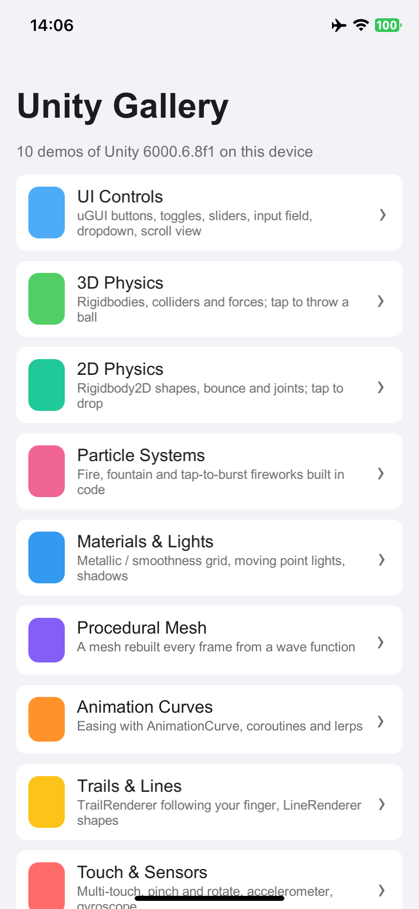
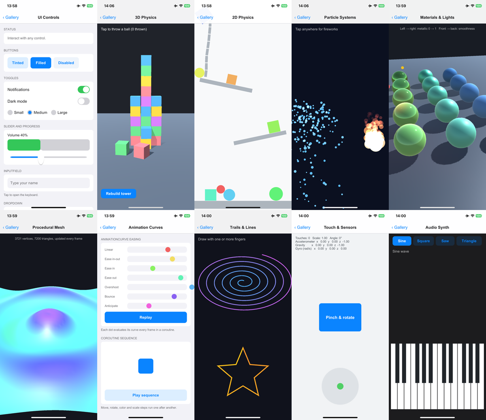

<div align="center">

# Unity Gallery

**English** · [简体中文](README_zh.md)

10 Unity 6 demos in one mobile app: uGUI controls, 3D and 2D physics, particle systems, Standard-shader materials and lights, a procedural mesh, animation curves, trails and lines, multi-touch and motion sensors, and a synthesizer.<br/>
Everything is C# that builds its objects at runtime, so the scene is empty and each demo is one readable class.<br/>
Exports to an iOS project that builds and runs on iPhone from Windows, Linux or macOS with [KXBuild](https://github.com/kxbuild/kxbuild).



</div>

## What's inside

| Demo | Shows |
|---|---|
| **UI Controls** | uGUI `Button`, switch-style `Toggle`, radio `ToggleGroup`, `Slider` with a progress bar, `InputField`, `Dropdown`, nested `ScrollRect` |
| **3D Physics** | A tower of `Rigidbody` boxes; tap to throw a heavy ball with continuous collision detection |
| **2D Physics** | `Rigidbody2D` circles and boxes with bouncy materials, angled shelves, a `HingeJoint2D` chain; tap to drop |
| **Particle Systems** | Fountain, additive flame with color and size over lifetime, tap-to-burst fireworks, all configured in code |
| **Materials & Lights** | A metallic × smoothness grid of Standard-shader spheres, three moving point lights, soft shadows; drag to orbit, pinch to zoom |
| **Procedural Mesh** | A 3,600-quad grid whose vertices, colors and normals are rebuilt every frame from a wave function |
| **Animation Curves** | Seven `AnimationCurve` easings side by side, and a coroutine sequence of moves, rotation, color and scale |
| **Trails & Lines** | A `TrailRenderer` per finger, an animated `LineRenderer` spiral and a star |
| **Touch & Sensors** | Touch markers, a pinch / rotate card, a bubble level from the accelerometer, gyroscope readings |
| **Audio Synth** | A two-octave multi-touch keyboard; sine / square / saw / triangle waves generated in `OnAudioFilterRead` |



## Run it on an iPhone

You need Unity 6 (6000.6) with iOS Build Support, KXBuild ([install guide](https://github.com/kxbuild/kxbuild#-install)) and [signing](https://github.com/kxbuild/kxbuild#-signing) set up.

```shell
git clone https://github.com/kxbuild/unity-gallery.git
cd unity-gallery

# Export the iOS project into export/ios (or use the Gallery > Export iOS Project menu in the editor)
Unity -batchmode -quit -projectPath . -executeMethod KXGallery.Editor.BuildiOS.Export

# Build, install on the USB-connected iPhone and launch it
cd export/ios
kxbuild doctor ./Unity-iPhone.xcodeproj
kxbuild run ./Unity-iPhone.xcodeproj -t Unity-iPhone -c Release
```

`Unity` stands for the editor executable (`Unity.exe` on Windows). The export sets the bundle identifier to `com.kxbuild.unitygallery`; to use your own, change it in `Assets/Editor/BuildiOS.cs` and export again. On Windows, keep the project in a short path such as `D:\unity-gallery`, because Unity exports nest deeply.

To open one demo right away, pass its id as a launch argument, for example `--args "-demo particles"`. The ids are in [Gallery.cs](Assets/Scripts/Gallery.cs).

## Run it in the editor

Open the folder with Unity Hub, open `Assets/Scenes/Main.unity` and press Play. Mouse clicks act as touches.

## Project layout

```
Assets/Scripts/Gallery.cs           menu, navigation bar and demo host (boots itself after the scene loads)
Assets/Scripts/UIFactory.cs         uGUI elements built in code
Assets/Scripts/Demos/*.cs           the demos, one class each
Assets/Editor/BuildiOS.cs           player settings and the iOS export
Assets/Scenes/Main.unity            an empty scene
```

To add a demo, write a class that derives from `Demo`, build its objects in `Build()`, and add an entry to `Entries` in `Gallery.cs`. Shaders looked up with `Shader.Find` must be listed in `RuntimeShaders` in `BuildiOS.cs`.

## Related repositories

- [**KXBuild**](https://github.com/kxbuild/kxbuild): build, run and publish iOS apps from Windows, Linux or macOS, on the command line or in VS Code
- [SwiftUI Gallery](https://github.com/kxbuild/swift-gallery): 15 SwiftUI demos: controls, lists, animation, gestures, Swift Charts, MapKit, SwiftData
- [UIKit Gallery (Objective-C)](https://github.com/kxbuild/objc-gallery): 14 UIKit demos in Objective-C, every view built in code
- [Flutter Gallery](https://github.com/kxbuild/flutter-gallery): Material and Cupertino widgets plus four complete sample apps
- [React Native Gallery](https://github.com/kxbuild/react-native-gallery): 16 demos of React Native's built-in components and APIs
- [Expo Gallery](https://github.com/kxbuild/expo-gallery): 22 Expo SDK modules: camera, sensors, location, SQLite and more
- [Godot Gallery](https://github.com/kxbuild/godot-gallery): 10 Godot 4 demos exported to iOS
- [KXBuild App Templates](https://github.com/kxbuild/kxbuild-app-templates): Project and target templates for `kxbuild project create` and `add-target`

## License

Apache 2.0. See [LICENSE](LICENSE). Unity is a trademark of Unity Technologies.
