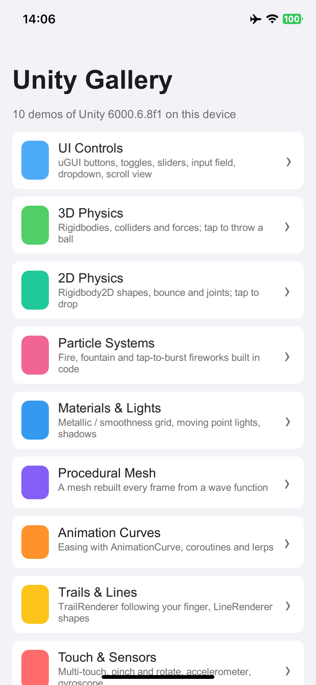
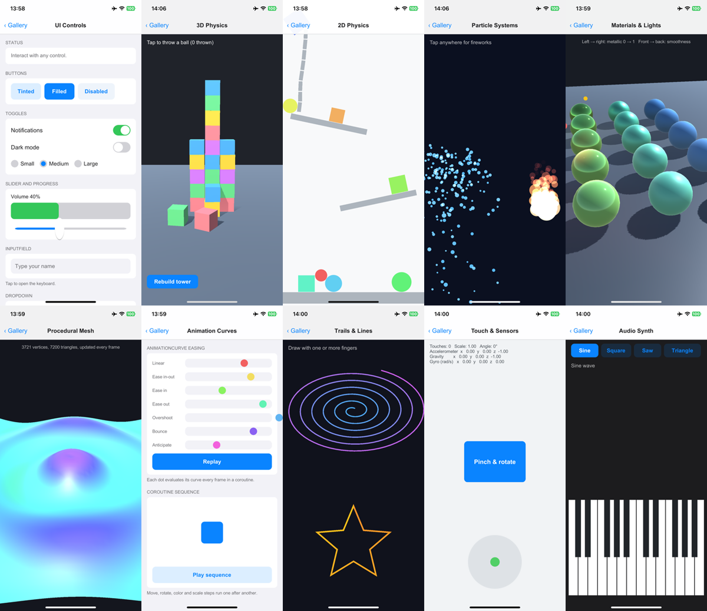

<div align="center">

# Unity Gallery

[English](README.md) · **简体中文**

一个移动应用里集中展示 10 个 Unity 6 示例：uGUI 控件、3D 与 2D 物理、粒子系统、Standard 着色器材质与灯光、程序化网格、动画曲线、拖尾与线条、多点触控与运动传感器，以及一个合成器。<br/>
全部是在运行时创建对象的 C# 代码，场景是空的，每个示例就是一个易读的类。<br/>
导出为 iOS 工程后，在 Windows、Linux、macOS 上用 [KXBuild](https://github.com/kxbuild/kxbuild) 即可编译并安装到 iPhone 上运行。



</div>

## 包含内容

| 示例 | 展示内容 |
|---|---|
| **UI Controls** | uGUI `Button`、开关样式的 `Toggle`、单选 `ToggleGroup`、带进度条的 `Slider`、`InputField`、`Dropdown`、嵌套 `ScrollRect` |
| **3D Physics** | `Rigidbody` 方块搭成的塔；点击扔出开启连续碰撞检测的重球 |
| **2D Physics** | 带弹性材质的 `Rigidbody2D` 圆与方块、倾斜挡板、`HingeJoint2D` 链条；点击投放 |
| **Particle Systems** | 喷泉、带生命周期颜色与尺寸变化的叠加火焰、点击绽放烟花，全部用代码配置 |
| **Materials & Lights** | 金属度 × 光滑度的 Standard 着色器球体阵列、三盏移动的点光源、软阴影；拖动环绕视角，双指缩放 |
| **Procedural Mesh** | 3600 个四边形的网格，每帧按波动函数重算顶点、颜色和法线 |
| **Animation Curves** | 七种 `AnimationCurve` 缓动并排对比，以及由协程驱动的移动、旋转、变色、缩放序列 |
| **Trails & Lines** | 每根手指一条 `TrailRenderer`，带动画的 `LineRenderer` 螺旋线和五角星 |
| **Touch & Sensors** | 触点标记、可双指缩放旋转的卡片、基于加速度计的水平仪、陀螺仪读数 |
| **Audio Synth** | 两个八度的多点触控键盘，在 `OnAudioFilterRead` 里实时生成正弦 / 方波 / 锯齿波 / 三角波 |



## 在 iPhone 上运行

准备：已安装带 iOS Build Support 的 Unity 6（6000.6）、KXBuild（[安装说明](https://github.com/kxbuild/kxbuild/blob/main/README_zh.md)），并配置好[签名](https://github.com/kxbuild/kxbuild/blob/main/README_zh.md)。

```shell
git clone https://github.com/kxbuild/unity-gallery.git
cd unity-gallery

# 把 iOS 工程导出到 export/ios（也可以在编辑器里用 Gallery > Export iOS Project 菜单）
Unity -batchmode -quit -projectPath . -executeMethod KXGallery.Editor.BuildiOS.Export

# 编译，安装到 USB 连接的 iPhone 并启动
cd export/ios
kxbuild doctor ./Unity-iPhone.xcodeproj
kxbuild run ./Unity-iPhone.xcodeproj -t Unity-iPhone -c Release
```

`Unity` 指编辑器可执行文件（Windows 上是 `Unity.exe`）。导出时 Bundle ID 设为 `com.kxbuild.unitygallery`；要换成你自己的，修改 `Assets/Editor/BuildiOS.cs` 后重新导出。Windows 上请把项目放在较短的路径下，例如 `D:\unity-gallery`，因为 Unity 导出的目录层级很深。

想启动后直接打开某个示例，把它的 id 作为启动参数传入，例如 `--args "-demo particles"`。全部 id 见 [Gallery.cs](Assets/Scripts/Gallery.cs)。

## 在编辑器里运行

用 Unity Hub 打开本目录，打开 `Assets/Scenes/Main.unity` 后点 Play，鼠标点击等同于触摸。

## 目录结构

```
Assets/Scripts/Gallery.cs           菜单、导航栏和示例容器（场景加载后自动启动）
Assets/Scripts/UIFactory.cs         用代码创建 uGUI 元素
Assets/Scripts/Demos/*.cs           各个示例，每个一个类
Assets/Editor/BuildiOS.cs           Player 设置和 iOS 导出
Assets/Scenes/Main.unity            空场景
```

新增示例：写一个继承 `Demo` 的类，在 `Build()` 里创建对象，再到 `Gallery.cs` 的 `Entries` 里加一项。用 `Shader.Find` 查找的着色器需要加进 `BuildiOS.cs` 的 `RuntimeShaders`。

## 相关仓库

- [**KXBuild**](https://github.com/kxbuild/kxbuild)：在 Windows、Linux、macOS 上编译、运行、发布 iOS App 的命令行工具和 VS Code 插件
- [SwiftUI Gallery](https://github.com/kxbuild/swift-gallery)：15 个 SwiftUI 示例：控件、列表、动画、手势、Swift Charts、MapKit、SwiftData
- [UIKit Gallery（Objective-C）](https://github.com/kxbuild/objc-gallery)：14 个 Objective-C 编写的 UIKit 示例，所有视图都在代码里创建
- [Flutter Gallery](https://github.com/kxbuild/flutter-gallery)：Material 与 Cupertino 组件，外加四个完整示例应用
- [React Native Gallery](https://github.com/kxbuild/react-native-gallery)：16 个 React Native 内置组件与 API 示例
- [Expo Gallery](https://github.com/kxbuild/expo-gallery)：22 个 Expo SDK 模块：相机、传感器、定位、SQLite 等
- [Godot Gallery](https://github.com/kxbuild/godot-gallery)：10 个 Godot 4 示例，导出为 iOS 工程
- [KXBuild 应用模板](https://github.com/kxbuild/kxbuild-app-templates)：`kxbuild project create` 和 `add-target` 使用的项目与 target 模板，欢迎贡献

## 许可证

Apache 2.0，见 [LICENSE](LICENSE)。Unity 是 Unity Technologies 的商标。
